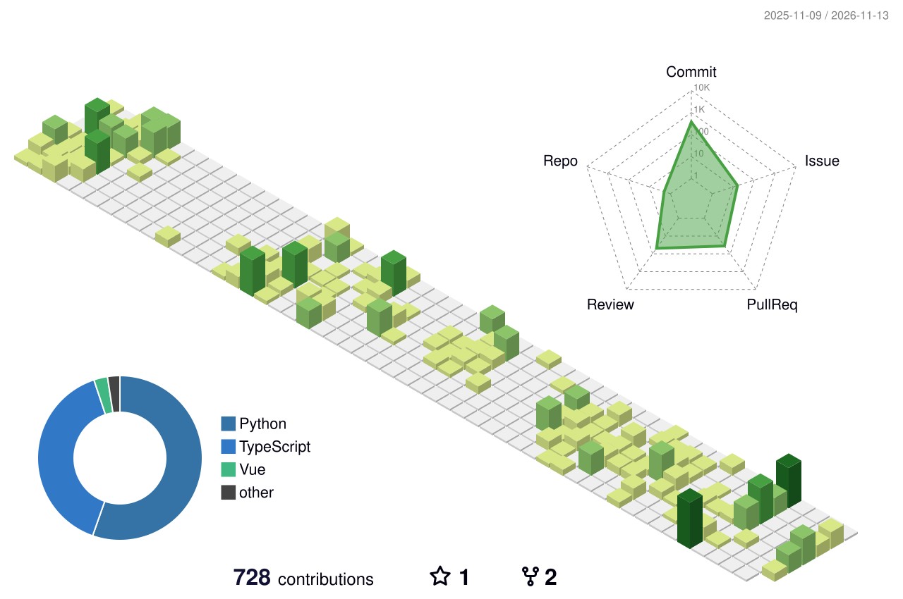
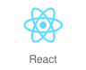
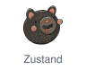
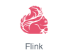

## 안녕하세요👋, 개발자 임규영입니다

데이터가 수집되고, 분석되고, 화면에 닿기까지의 과정 전체에 관심이 있습니다.

- **Frontend** — React와 TypeScript로 화면을 만듭니다. 실시간 데이터 처리를 직접 구현해 보면서, 들어오는 데이터를 사용자에게 어떻게 보여줘야 한눈에 읽힐지 고민하고 있습니다.
- **Data Science** — 이미지·텍스트 데이터를 전처리하고 특성을 추출해, 데이터에서 의미 있는 결과를 찾는 방법을 공부하고 있습니다.
- **Data Engineering** — Kafka, Spark, Flink로 데이터를 수집하고 처리하는 파이프라인을 배우고 있습니다.

현재 **SSAFY Data Track 16기**에서 교육받고 있습니다.

<picture>
  <source media="(prefers-color-scheme: dark)" srcset="https://raw.githubusercontent.com/gxuoo/gxuoo/output/profile-night-green.svg" />
  <source media="(prefers-color-scheme: light)" srcset="https://raw.githubusercontent.com/gxuoo/gxuoo/output/profile-green-animate.svg" />
  
</picture>

## Tech Stack

### Frontend

  <picture>
    <source media="(prefers-color-scheme: dark)" srcset="./assets/stack/react-dark.svg" />
    
  </picture>
  <picture>
    <source media="(prefers-color-scheme: dark)" srcset="./assets/stack/typescript-dark.svg" />
    
  </picture>
  <picture>
    <source media="(prefers-color-scheme: dark)" srcset="./assets/stack/javascript-dark.svg" />
    
  </picture>
  <picture>
    <source media="(prefers-color-scheme: dark)" srcset="./assets/stack/tailwindcss-dark.svg" />
    
  </picture>
  <picture>
    <source media="(prefers-color-scheme: dark)" srcset="./assets/stack/vite-dark.svg" />
    
  </picture>

  <picture>
    <source media="(prefers-color-scheme: dark)" srcset="./assets/stack/tanstack-query-dark.svg" />
    
  </picture>
  <picture>
    <source media="(prefers-color-scheme: dark)" srcset="./assets/stack/zustand-dark.svg" />
    
  </picture>
  <picture>
    <source media="(prefers-color-scheme: dark)" srcset="./assets/stack/react-hook-form-dark.svg" />
    
  </picture>
  <picture>
    <source media="(prefers-color-scheme: dark)" srcset="./assets/stack/zod-dark.svg" />
    
  </picture>

  <picture>
    <source media="(prefers-color-scheme: dark)" srcset="./assets/stack/vitest-dark.svg" />
    
  </picture>
  <picture>
    <source media="(prefers-color-scheme: dark)" srcset="./assets/stack/testing-library-dark.svg" />
    
  </picture>
  <picture>
    <source media="(prefers-color-scheme: dark)" srcset="./assets/stack/msw-dark.svg" />
    
  </picture>
  <picture>
    <source media="(prefers-color-scheme: dark)" srcset="./assets/stack/playwright-dark.svg" />
    
  </picture>

### Data

  <picture>
    <source media="(prefers-color-scheme: dark)" srcset="./assets/stack/python-dark.svg" />
    
  </picture>
  <picture>
    <source media="(prefers-color-scheme: dark)" srcset="./assets/stack/pandas-dark.svg" />
    
  </picture>
  <picture>
    <source media="(prefers-color-scheme: dark)" srcset="./assets/stack/numpy-dark.svg" />
    
  </picture>
  <picture>
    <source media="(prefers-color-scheme: dark)" srcset="./assets/stack/matplotlib-dark.svg" />
    
  </picture>
  <picture>
    <source media="(prefers-color-scheme: dark)" srcset="./assets/stack/scikit-learn-dark.svg" />
    
  </picture>

  <picture>
    <source media="(prefers-color-scheme: dark)" srcset="./assets/stack/kafka-dark.svg" />
    
  </picture>
  <picture>
    <source media="(prefers-color-scheme: dark)" srcset="./assets/stack/spark-dark.svg" />
    
  </picture>
  <picture>
    <source media="(prefers-color-scheme: dark)" srcset="./assets/stack/flink-dark.svg" />
    
  </picture>

  <picture>
    <source media="(prefers-color-scheme: dark)" srcset="./assets/stack/django-dark.svg" />
    
  </picture>
  <picture>
    <source media="(prefers-color-scheme: dark)" srcset="./assets/stack/mysql-dark.svg" />
    
  </picture>

### Tools

  <picture>
    <source media="(prefers-color-scheme: dark)" srcset="./assets/stack/git-dark.svg" />
    
  </picture>
  <picture>
    <source media="(prefers-color-scheme: dark)" srcset="./assets/stack/github-dark.svg" />
    
  </picture>
  <picture>
    <source media="(prefers-color-scheme: dark)" srcset="./assets/stack/docker-dark.svg" />
    
  </picture>
  <picture>
    <source media="(prefers-color-scheme: dark)" srcset="./assets/stack/postman-dark.svg" />
    
  </picture>
  <picture>
    <source media="(prefers-color-scheme: dark)" srcset="./assets/stack/colab-dark.svg" />
    
  </picture>

  <picture>
    <source media="(prefers-color-scheme: dark)" srcset="./assets/stack/notion-dark.svg" />
    
  </picture>
  <picture>
    <source media="(prefers-color-scheme: dark)" srcset="./assets/stack/jira-dark.svg" />
    
  </picture>
  <picture>
    <source media="(prefers-color-scheme: dark)" srcset="./assets/stack/confluence-dark.svg" />
    
  </picture>
  <picture>
    <source media="(prefers-color-scheme: dark)" srcset="./assets/stack/figma-dark.svg" />
    
  </picture>

  <picture>
    <source media="(prefers-color-scheme: dark)" srcset="./assets/stack/claude-dark.svg" />
    
  </picture>
  <picture>
    <source media="(prefers-color-scheme: dark)" srcset="./assets/stack/codex-dark.svg" />
    
  </picture>

