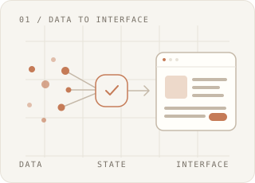

<picture>
  <source media="(prefers-color-scheme: dark)" srcset="https://capsule-render.vercel.app/api?type=venom&amp;color=gradient&amp;height=200&amp;section=header&amp;text=gxuoo%27s%20GITHUB&amp;fontSize=60&amp;fontAlignY=40&amp;desc=From%20Data%20to%20Interface&amp;descSize=18&amp;descAlignY=62" />
  
</picture>

  

<table>
  <tr>
    <td width="60%" valign="top">
      <samp>FRONTEND DEVELOPER</samp>
      <h2>임규영</h2>
      

        React와 TypeScript로 인터페이스를 만듭니다. 
        데이터가 사용자에게 도달하는 과정에 관심이 있습니다.
      

      

        처리 중인 상태를 어떻게 알릴지, 
        결과를 어떻게 이해하기 쉽게 보여줄지 고민합니다.
      

      

        EMAIL 
        <a href="mailto:rbdud986@gmail.com">rbdud986@<wbr />gmail.com</a>
      

    </td>
    <td width="40%" valign="top">
      <samp>EXPLORING</samp>
        
      <picture>
        <source media="(prefers-color-scheme: dark)" srcset="./assets/flow-dark.svg" />
        
      </picture>
      
<strong>데이터가 화면이 되기까지</strong>

      

        이미지·텍스트 전처리와 특성 추출, 
        비동기 작업의 상태 표현을 공부하고 있습니다.
      

      

        
        
      

    </td>
  </tr>
  <tr>
    <td colspan="2">
      <samp>TECH STACK</samp>
    </td>
  </tr>
  <tr>
    <td width="60%" valign="top">
      
<strong>Frontend</strong>

      

        <picture>
          <source media="(prefers-color-scheme: dark)" srcset="https://skillicons.dev/icons?i=react,ts,tailwind,vite&amp;theme=dark" />
          
        </picture>
      

      
<strong>State &amp; Forms</strong>

      

        
        
        
        
      

    </td>
    <td width="40%" valign="top">
      
<strong>Languages</strong>

      

        <picture>
          <source media="(prefers-color-scheme: dark)" srcset="https://skillicons.dev/icons?i=js,py&amp;theme=dark" />
          
        </picture>
      

      
<strong>Testing</strong>

      

        
        
        
        
      

    </td>
  </tr>
</table>

 

### GitHub Activity

  <picture>
    <source media="(prefers-color-scheme: dark)" srcset="https://github-readme-stats.vercel.app/api?username=gxuoo&amp;show_icons=true&amp;hide_rank=true&amp;hide_border=true&amp;bg_color=00000000&amp;title_color=E3A17D&amp;text_color=C9D1D9&amp;icon_color=E3A17D" />
    
  </picture>
  <picture>
    <source media="(prefers-color-scheme: dark)" srcset="https://github-readme-stats.vercel.app/api/top-langs/?username=gxuoo&amp;layout=compact&amp;hide_border=true&amp;bg_color=00000000&amp;title_color=E3A17D&amp;text_color=C9D1D9" />
    
  </picture>

 

### User Profile

| 구분            | 내용                                                                                                                                                                               |
| :-------------- | :--------------------------------------------------------------------------------------------------------------------------------------------------------------------------------- |
| **학력**        | **세종대학교 · 소프트웨어학 학사** 2020.03.02 – 2026.08.21                                                                                                                    |
| **교육**        | **SSAFY · Data Track 16기** 교육 중                                                                                                                                           |
| **동아리 활동** | **[GREEDY 개발 동아리](https://github.com/greedy-team)** 프론트엔드 스터디 · 스터디 리드 · 코드 리뷰어  **세콕세콕 배드민턴 동아리** 사무부 운영진 · 1년 6개월 |
| **수상**        | **제12회 세종대학교 SW·AI 해커톤** 장려상 · 2025.06.26                                                                                                                        |
